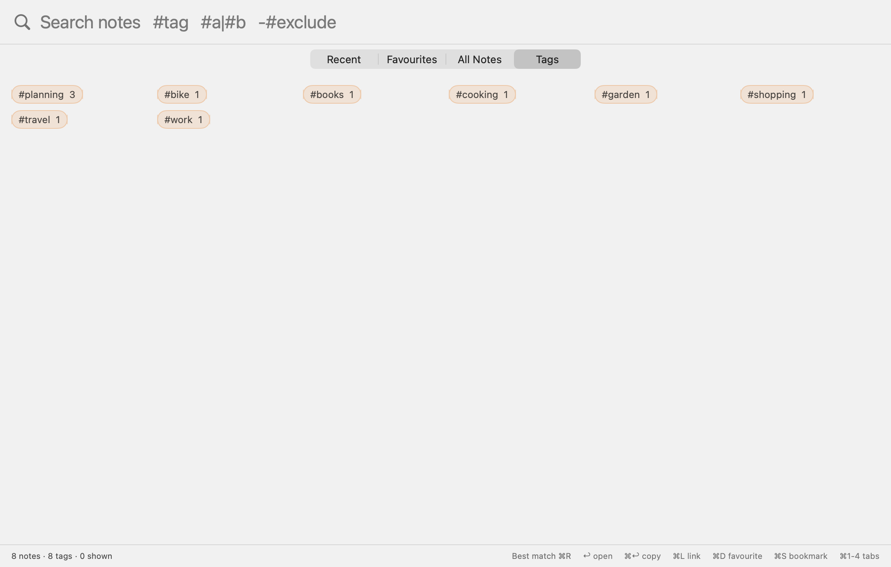

# NoteSleuth

A fast, keyboard-driven menu-bar search for **Apple Notes** on macOS 14+ (Apple silicon and Intel). Formerly QuickNoteSearch.




- **Instant fuzzy search** over titles, folders and note bodies: prefix matching, one-typo tolerance, fuzzy title matching. Searches run in parallel across all CPU cores (~20 ms for 10,000 notes).
- **Hashtags**: `#work #urgent` (both), `#work|#home` (either), `-#archive` (exclude). Press ⇥ to autocomplete tags.
- **Exact phrases**: `"project plan"` matches those words together, in that order.
- **Folder and account filter**: `in:work` limits results to folders or accounts whose name starts with "work"; `in:"my folder"` for names with spaces.
- **To-dos**: `is:todo` finds notes that still have an unticked checklist item.
- **Tables and links**: text inside tables is searchable, and so are link addresses (`github.com`).
- **Tag browser** (⌘4): every hashtag with its note count.
- **Jump to the match**: the preview scrolls to the first matching line; ⌘G / ⇧⌘G step through the rest.
- **Live index** that stays in sync. It watches the Notes database with FSEvents, re-reads only the notes that changed, and is throttled so it stays idle when nothing changes.
- **Popup on a global hotkey** (default ⌥Space, configurable), with a preview pane that highlights matches.
- **Favourites** (⌘D), **recently opened** notes, **recent hashtags**, **bookmarked searches** (⌘S).
- **Per-note global hotkeys**: assign one from the preview pane or in Settings → Note Hotkeys.
- **Launch at login**, plus a detailed Settings window.
- **Automatic updates** through [Sparkle](https://sparkle-project.org).

## Privacy

Your notes never leave your Mac. NoteSleuth opens the Notes database read-only and keeps its search index in memory; nothing is written to disk except your favourites, history, bookmarks and hotkeys, which are stored as note IDs. The only network request is the update check against this repository's `appcast.xml`, which sends nothing about your notes. **Settings → General → Copy Diagnostics** copies counts only (no titles or text) for problem reports.

## Install

With Homebrew:

```bash
brew tap giridharmb/notesleuth https://github.com/giridharmb/NoteSleuth
```

```bash
brew install --cask notesleuth
```

Or download `NoteSleuth-<version>.dmg` from [Releases](https://github.com/giridharmb/NoteSleuth/releases), open it and drag **NoteSleuth** to **Applications**. The app is signed with Developer ID and notarized by Apple.

On first launch, a welcome window walks you through granting **Full Disk Access** (see [Permissions](#permissions)). Updates install automatically, or use **Check for Updates…** in the menu bar menu.

## Build

Requires Xcode 15+ / Swift 5.10+.

```bash
./scripts/build_app.sh            # → build/NoteSleuth.app
./scripts/build_app.sh --install  # also copies to /Applications and launches
swift test                        # unit tests (decoder, schema, search)
./scripts/make_dmg.sh             # Developer ID–signed build/NoteSleuth-<version>.dmg
NOTARY_PROFILE=<profile> ./scripts/make_dmg.sh   # …also notarized, stapled, and appcast.xml regenerated
```

Builds are universal (arm64 + x86_64). Releases: bump the version in `Support/Info.plist`, run `make_dmg.sh` with `NOTARY_PROFILE`, upload the DMG to a `v<version>` GitHub release, then commit `appcast.xml`. The appcast is signed with a Sparkle EdDSA key kept in your keychain under the account `QuickNoteSearch` (create it once with `.build/artifacts/sparkle/Sparkle/bin/generate_keys --account QuickNoteSearch`, and back it up: without it you can't ship updates to existing installs).

`make_dmg.sh` needs a *Developer ID Application* certificate. For notarization, first save your credentials once with `xcrun notarytool store-credentials <profile>`.

If an *Apple Development* or *Developer ID* certificate is in your keychain, the app is signed with it, so the Full Disk Access grant survives rebuilds. Otherwise it is signed ad-hoc and you must re-grant access after every rebuild. Set `SIGN_ID` to choose a specific identity.

## Permissions

| Permission | Why |
|---|---|
| **Full Disk Access** | Notes stores its data in `~/Library/Group Containers/group.com.apple.notes/NoteStore.sqlite`, which macOS protects. The app opens it **read-only**. |
| **Automation → Notes** | Used to ask Notes to show the note you picked. |

## Popup keys

| Key | Action |
|---|---|
| ↑ ↓ / ⌃N ⌃P / PgUp PgDn | Move selection |
| ↩ | Open in Notes |
| ⌘↩ | Copy note text |
| ⇥ | Complete `#tag` |
| ⌘D | Toggle favourite |
| ⌘S | Bookmark current search |
| ⌘L | Copy a link to the note |
| ⌘R | Switch between best match and newest first |
| ⌘G / ⇧⌘G | Next / previous matching line in the preview |
| ↑ in an empty search box | Recall earlier searches |
| ⌘1 / ⌘2 / ⌘3 / ⌘4 | Recent / Favourites / All notes / Tags |
| ⎋ | Clear search, then close |
| ⌘, | Settings |

## How it works

`NoteStore.sqlite` is Notes' Core Data store. Each note body is a gzipped protobuf (`NoteStoreProto → Document → Note.note_text`). Hashtags are inline attachments (`com.apple.notes.inlinetextattachment.hashtag`). The schema is undocumented, so column names are checked at runtime. A Notes update that changes the format shows an error in Settings → Index instead of crashing.

The index lives **in memory only**. Writing note contents to a cache file would expose them to apps that don't have Full Disk Access. Favourites, history, bookmarks and hotkeys are stored in UserDefaults as note IDs only.

The popup can be resized and moved; it remembers both. Folders listed under **Settings → Index → Folders to leave out** are never indexed.

Limitations: table cells are searchable but shown as a flat list, not a grid. The contents of locked (password-protected) notes are encrypted, so only their titles are searchable. The app never edits notes.

## License

[MIT](LICENSE)
